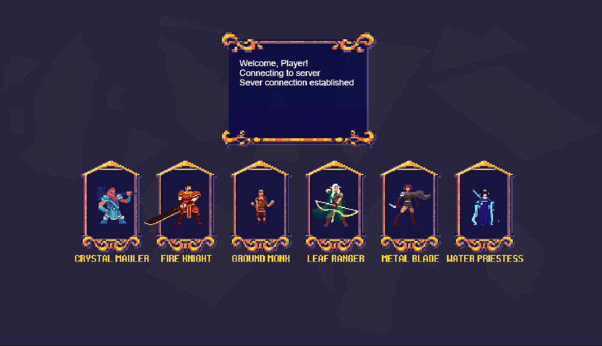
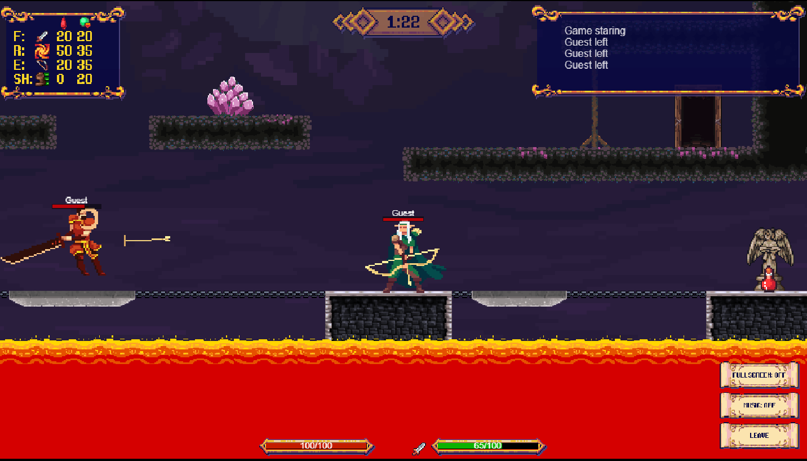
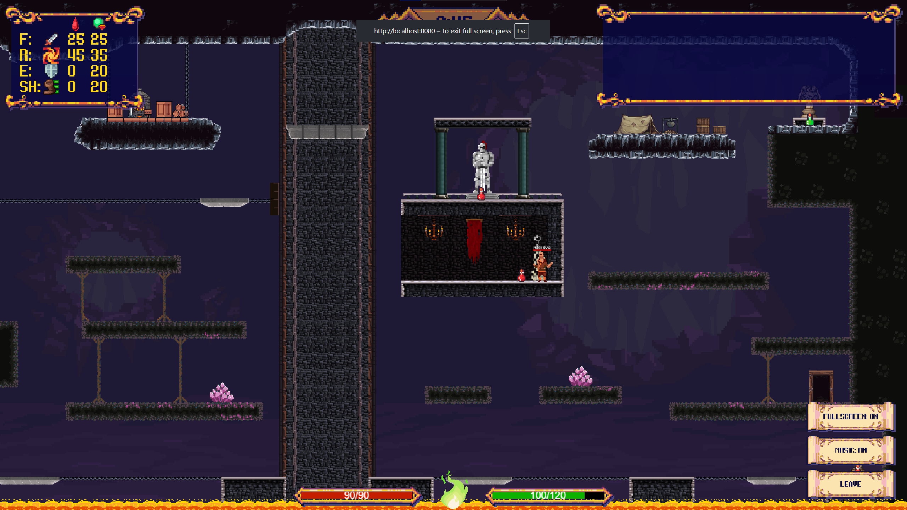

# Elemental Arena

A multiplayer web-based 2D platformer fighting game built with Phaser 4, React, and Node.js — featuring real-time lockstep networking, animated combat, and multiple game modes. The objective of the project was to learn netcode for competitive multiplayer while also working on game design and enginge architecure. Was made for project ft_transcendence as part of the Schoool 42 curriculum.

---


**Character Selection**


**In-Game Combat**


**Cave Map View**


---

## Gameplay Overview

Elemental Arena is a 2D side-scrolling platformer brawler where players choose a character and a map, join a matchmaking queue, and fight in real-time against other players. Combat is animation-driven and consists in attacks, blocks and dodges, as well as in navigating the map and its obstacles.

---

## Main Features

### Characters
6 playable characters, each with unique stats, move animations, and elemental-themed abilities. Each character has distinct parameters: speed, jump force, HP, energy, poise, gravity, attack damage, and cooldowns — all data-driven from JSON config files, which makes it very easy to add new characters or configure existing ones.

### Combat System

- **Animation-based**: attack windows (start/end frames), hitbox activation and interruption by enemy attack
- **Action types**: melee, ranged/block, dodge, and stagger reactions and a special attack that requires charges
- **Knockback**: physics-based pushback scaled by damage and the target's poise stat
- **Projectiles**: hitscan and physics-based projectiles 
- **Pickups**: HP potions and energy potions that spawn on player death and at fixed locations

### Maps & Game Modes

3 maps supporting distinct game modes:

| Map | Mode | Players |
|---|---|---|
| Cave Duel | 1v1 Duel | 2 |
| Cave Chaos | Free-for-All | 4+ |
| Team Fortress | Team Battle | 4+ (2v2+) |

Maps feature parallax backgrounds, animated elements and dynamic obstacles.

### Matchmaking

- Players select a character and map from the main menu
- A per-map queue system places players into pending matches as slots fill
- Players can reconnect withing a time-out

### HUD & UI

- Real-time health bars and energy bars
- Kill/death scoreboard updated live during the match
- Match timer countdown
- Frag/event announcements (kills, deaths, disconnects, game start/end)

---

## Architecture

### Lockstep Networking

The game uses a **deterministic lockstep** model over **Socket.IO** (WebSocket):

- The server runs the authoritative physics simulation at a fixed 60 FPS tick rate and broadcasts world snapshots to all clients every few frames.
- Clients run a local copy of the same simulation for prediction, sending stamped inputs each tick.
- On receiving a snapshot, the client reconciles by rewinding to the snapshot tick, re-importing server state, and re-simulating up to the current predicted tick — smoothing out any discrepancy over a correction window.
- A lookahead/lookback buffer (configurable) absorbs network jitter and determines how far ahead the client runs relative to the server.


## Tech Stack

| Layer | Technology |
|---|---|
| **Language** | TypeScript |
| **Game Engine** | [Phaser 4](https://phaser.io/) |
| **Physics** | [Matter.js](https://brm.io/matter-js/) |
| **UI Framework** | [React 19](https://react.dev/) |
| **Networking** | [Socket.IO 4](https://socket.io/) (WebSocket) |
| **Server Runtime** | Node.js ≥ 18 (`tsx` for TypeScript execution) |
| **Bundler** | [Vite 6](https://vitejs.dev/) |
| **Event System** | [EventEmitter3](https://github.com/primus/eventemitter3) |

---

## Installation and Usage

### Prerequisites
- Node.js **≥ 18**

### Install

```bash
git clone <repo-url>
cd transcendence
npm install
```

### Run (Development)

Start the game server and the Vite dev server in two terminals:

```bash
# Terminal 1 — game server
npm run server

# Terminal 2 — client dev server
npm run dev
```

Then open `http://localhost:8080` (or the port Vite reports) in your browser.

### Build (Production)

```bash
npm run build
```

The bundled client will be output to `dist/`. The server can be started with:

```bash
npm run server
```

### Configuration

All game parameters live in [`public/config/config.json`](public/config/config.json) Maps, characters, game objects, and audio are all declared in the same config file, making the game fully data-driven.

---

## Controls

Default keybindings (configurable in `public/config/keymap.json`):

| Action | Key |
|---|---|
| Move Left / Right | `A` / `D` |
| Jump | `Space` |
| Melee Attack | `F` |
| Special Attack | `R` |
| Ranged / Secondary | `E` |
| Dodge | `Shift` |

---

## Credits

As far as I can tell, all assets are human-made. A big thank you to itch.io user chierit for creating the character sprites, this project wouldn't be possible without them. Also many thanks to the other authors whose assets are used here:

| Asset | Author |
|---|---|
| Characters (Elementals Bundle) | [chierit](https://chierit.itch.io/elementals-bundle) |
| Cave Tileset | [cubeasset](https://cubeasset.itch.io/deep-cave-platformer) |
| Fortress Tileset | [free-game-assets](https://free-game-assets.itch.io/free-swamp-2d-tileset-pixel-art) |
| Platforms | [hxlite](https://hxlite.itch.io/kilang-factory-mechanical-industrial-tileset-16x16-side-scrolling-game) |
| Other Tiles | [marcengelgamedevelopment](https://marcengelgamedevelopment.itch.io/platformer-tileset) |
| Background (Hill) | [szadiart](https://szadiart.itch.io/bakcground-hill) |
| Shooting FX | [ansimuz](https://ansimuz.itch.io/warped-shooting-fx) |
| HUD / UI | [tiopalada](https://tiopalada.itch.io/tiny-rpg-mana-soul-gui) |
| Font (ThaleahFat) | [tinyworlds](https://tinyworlds.itch.io/free-pixel-font-thaleah) |
| Sound FX | [tommusic](https://tommusic.itch.io/free-fantasy-200-sfx-pack) |
| Music | [jacobstaffordmusic](https://jacobstaffordmusic.itch.io/mythical-battlegrounds) |

---

## 📄 License

This project is for educational / personal use. See individual asset credits above for their respective licenses.
